# 基于 I2C 的 OLED 显示与 U8g2 图形库移植

[TOC]

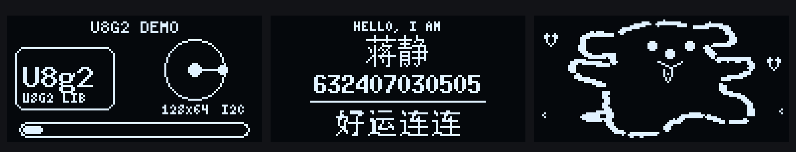

这次任务三的三个主画面：左边是 U8g2 Demo，中间是姓名学号页，右边是会动的线条小狗。

## 一、实验目的

:one:理解 I2C 总线的基本原理和时序协议，弄清楚起始、停止、地址、应答这些概念。

:two:掌握 0.96 寸 SSD1306 OLED 的工作原理，理解汉字点阵为什么是 16×16、32 个字节。

:three:掌握在 STM32F103C8T6 上用 HAL 库驱动 OLED 的方法，能完成姓名、学号、温湿度和长字符串滚动的显示。

:four:掌握开源 GUI 库 U8g2 在 STM32 上的裁剪、移植和编译方法，能用它画出自定义图案。

:five:用 U8g2 完成四段式动画：开头先播放 U8g2 demo；姓名、学号、长语句从左往右滑动；“好好学习天天向上”自上往下滚动；最后停在动态线条小狗页。

:six:理解 Keil 虚拟逻辑分析仪的适用边界，能解释为什么硬件 I2C 在仿真里经常“抓不到”真实波形。

## 二、实验准备

### 2.1 硬件

| 器件 | 型号/规格 | 数量 | 备注 |
| --- | --- | --- | --- |
| 主控 | STM32F103C8T6 最小系统板 | 1 | LQFP48，72 MHz，64 KB Flash，20 KB RAM |
| 显示屏 | 0.96 寸 OLED，SSD1306，128×64，I2C | 1 | 4 针：VCC/GND/SCL/SDA |
| 下载器 | ST-LINK | 1 | SWD 四线 |
| 面包板 | 830 孔 | 1 | 实际接线用 |
| 杜邦线 | 公对公 | 若干 | 红/黑/蓝/绿区分电源和信号 |
| 温湿度传感器 | SHT3X | 1 | I2C2：PB10/PB11 |

## 三、实验原理

### 3.1 I2C 总线

I2C 只用两根线：SCL 是时钟，SDA 是数据。两根线都是开漏结构，器件只能把线拉低，不能主动推高；高电平靠上拉电阻。所以 STM32 的 PB6/PB7 必须配置成“复用开漏”（`GPIO_MODE_AF_OD`），不能配成推挽。推挽输出会强行拉高，和从机的开漏输出“打架”，严重时甚至损坏引脚。

几个关键点：

:one:**起始条件**：SCL 为高时，SDA 由高变低。

:two:**停止条件**：SCL 为高时，SDA 由低变高。

:three:**数据有效**：SCL 为高期间 SDA 必须稳定；SDA 只能在 SCL 低电平期间改变。

:four:**应答**：主机发完 8 位后释放 SDA，从机在第 9 个时钟把 SDA 拉低，表示 ACK。

:five:**地址**：SSD1306 的 7 位地址是 `0x3C`，HAL 库使用 8 位地址，所以代码里写 `0x78`。

我用的是 100 kHz 标准模式，一个 bit 是 10 μs，一个字节 8 个数据位加 1 个应答位，一共 9 个时钟。

### 3.2 SSD1306 的显存组织

0.96 寸 OLED 的控制器是 SSD1306，分辨率 128×64。它不是“给一个坐标就画一个点”的屏幕，而是内部有一块 GDDRAM，MCU 通过 I2C 把显存数据写进去。

### 3.3 汉字点阵

16×16 汉字一共 256 个像素，按列优先、分上下两页存储，每个字 32 字节：

- 前 16 字节：上半页，y=0~7；
- 后 16 字节：下半页，y=8~15；
- 每个字节的 bit0 在最上面。

任务一里的 需添加`font.c`库， 把“蒋”“静”和滚动用的汉字取好。

```c
/* 蒋 */
const uint8_t HZ_JIANG[32] = {
    0x04, 0x44, 0x84, 0x04, 0xEF, 0x04, 0x84, 0x44, 0xB4, 0x24, 0xAF, 0x64, 0x24, 0x04, 0x04, 0x00,
    0x20, 0x10, 0x09, 0x04, 0xFF, 0x00, 0x04, 0x0C, 0x36, 0x05, 0x84, 0xFF, 0x04, 0x04, 0x04, 0x00,
};

/* 静 */
const uint8_t HZ_JING[32] = {
    0x44, 0x54, 0x54, 0x7F, 0x54, 0x54, 0x44, 0x20, 0x28, 0x27, 0xE4, 0x34, 0x2C, 0xE0, 0x00, 0x00,
    0x00, 0xFF, 0x15, 0x55, 0x95, 0x7F, 0x00, 0x09, 0x49, 0x89, 0x7F, 0x09, 0x09, 0x1F, 0x01, 0x00,
};
```

这两个数组可以用PCtoLCD2002软件提取出来

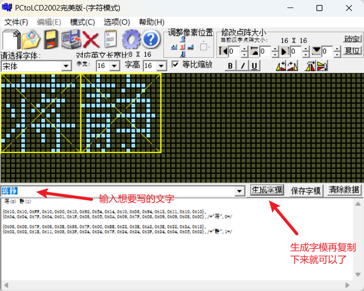

### 3.4 U8g2 是什么

U8g2 是面向单色显示屏的嵌入式图形库，支持 SSD1306、SH1106、ST7565 等一大堆控制器。它的好处是：

:one:自带驱动，不用自己写 SSD1306 的初始化命令；

:two:自带字库和绘图 API，画点、画线、画圆、画圆角框、显示字符串都只要一行；

:three:移植简单，只要实现“字节发送”和“延时/GPIO”两个回调，就能把整个库接到 STM32 上。

### 3.5 硬件原理核对

我先查了 STM32F103x8/xB 的数据手册，确认 LQFP48 封装下：

| 引脚号 | 引脚 | 默认复用功能 | 本实验用途 |
| --- | --- | --- | --- |
| 42 | PB6 | I2C1_SCL | OLED SCL |
| 43 | PB7 | I2C1_SDA | OLED SDA |

PB6/PB7 就是 I2C1 的默认引脚，不需要重映射。

这里有三个容易翻车的点：

:one:OLED 的 VCC 一定要接 3.3V，不要接 5V。SSD1306 模块有的带稳压，有的不带，接 5V 可能烧。

:two:SCL/SDA 需要上拉。大多数模块背面已经有 4.7k 上拉电阻。

:three:GND 必须共地。只接 SCL/SDA 不接 GND，波形会“浮”起来，I2C 一定不通。

接线图如下所示：

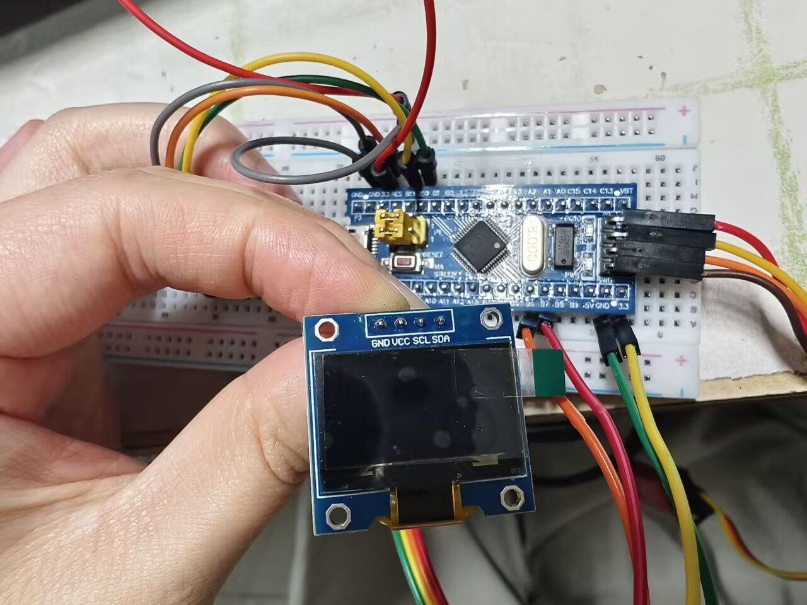

## 四、任务一：HAL 库驱动 OLED 显示

### 4.1 任务要求与实现思路

任务一要求：

:one:显示自己的姓名和学号；

:two:显示 SHT3X 的温度和湿度；

:three:上下或左右滑动显示长字符串，比如“Hello, 欢迎来到重庆交通大学物联网205实训室！”或者一段歌词；

:four:最好用硬件刷屏方式。

我的实现是把 128×64 分成 4 个区域：

| 页 | 内容 |
| --- | --- |
| 0~1 | “蒋静” + “632407030505” |
| 2~3 | 温度、湿度 |
| 4~5 | 长字符串左右循环滚动 |
| 6~7 | 传感器型号/地址和 I2C 总线状态 |

这样滚动的时候只刷新第 4~5 页，不用整屏刷新，画面不闪。

### 4.2 CubeMX 配置

任务一工程用的是 `OLED.ioc`，核心配置如下：

:one:RCC：HSE 外部晶振 8 MHz，PLL ×9，SYSCLK 72 MHz，APB1 二分频（36 MHz），APB2 不分频。

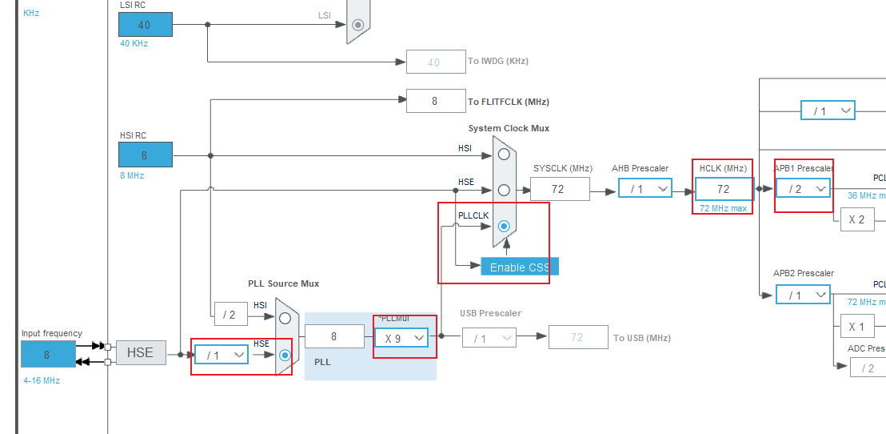

:two:SYS：Debug 选 Serial Wire

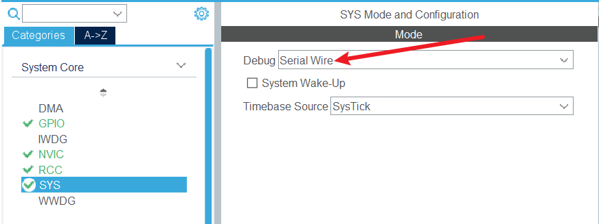

:three:I2C1：PB6=SCL，PB7=SDA，100 kHz，7 位地址。

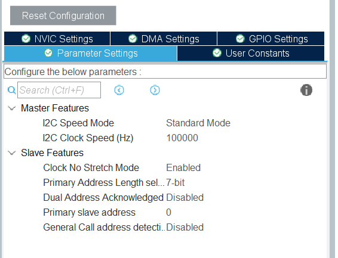

:four:Project Manager：MDK-ARM，生成工程

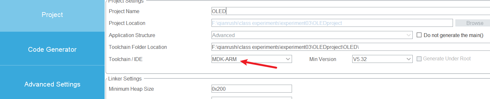

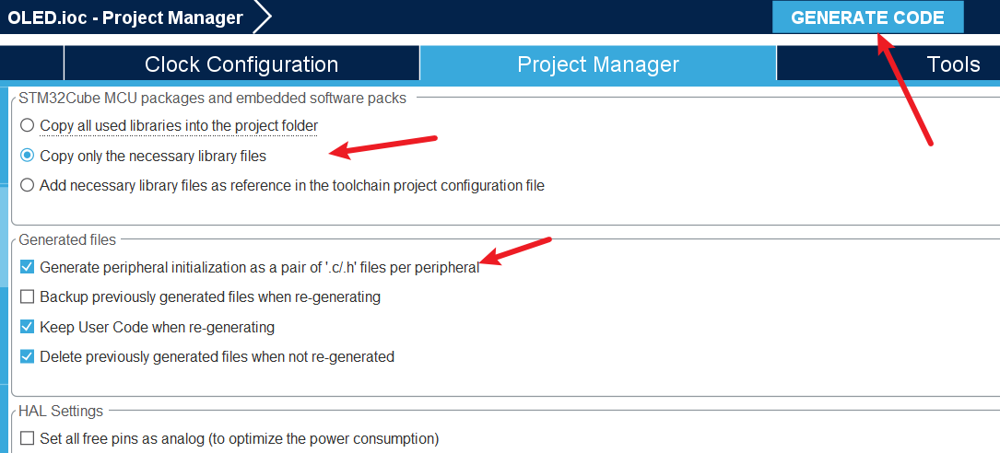

### 4.3 OLED 驱动

任务一的 OLED 驱动核心是“显存 + 局部刷新”。先看 `OLED_RefreshPages()`：

```c
void OLED_RefreshPages(uint8_t first_page, uint8_t page_num)
{
    static uint8_t buf[OLED_WIDTH + 1];
    uint8_t page, i;

    if (first_page >= OLED_PAGES) {
        return;
    }
    if ((uint8_t)(first_page + page_num) > OLED_PAGES) {
        page_num = (uint8_t)(OLED_PAGES - first_page);
    }

    buf[0] = OLED_CTRL_DATA;
    for (page = first_page; page < (uint8_t)(first_page + page_num); page++) {
        OLED_SetCursor(0, page);
        for (i = 0; i < OLED_WIDTH; i++) {
            buf[i + 1] = OLED_GRAM[page][i];
        }
        HAL_I2C_Master_Transmit(&hi2c1, OLED_I2C_ADDR, buf, OLED_WIDTH + 1,
                                OLED_I2C_TIMEOUT);
    }
}
```

这里 `buf[0] = 0x40` 是 SSD1306 的数据控制字节，表示后面跟的是显存数据；`OLED_SetCursor()` 先发 `0xB0 + page` 设置页，再发列地址的低 4 位和高 4 位。只发 `page_num` 页，所以滚动时不会整屏重画。

8×16 ASCII 字符的显示：

```c
void OLED_ShowChar(int16_t x, uint8_t page, char ch)
{
    const uint8_t *font;
    uint8_t i;

    if ((uint8_t)ch < 0x20U || (uint8_t)ch > 0x7EU) {
        ch = '?';
    }
    font = ASCII_8x16[(uint8_t)ch - 0x20U];

    for (i = 0; i < 8U; i++) {
        OLED_DrawColumn((int16_t)(x + i), page, font[i]);
        OLED_DrawColumn((int16_t)(x + i), (uint8_t)(page + 1U), font[i + 8U]);
    }
}
```

16×16 汉字则是把 32 字节分成上下两页，逐列写入。`x` 用 `int16_t` 是为了支持负数坐标，滚动时可以把字画到屏幕左边外面，再由 `OLED_DrawColumn()` 做裁剪。

### 4.4 主程序里的四个画面

姓名和学号：

```c
static void OLED_ShowNameAndId(void)
{
    OLED_ClearPages(0, 2);
    OLED_ShowChinese(0,  0, HZ_Jiang);   /* 蒋 */
    OLED_ShowChinese(16, 0, HZ_Jing);    /* 静 */
    OLED_ShowString(32,  0, "632407030505");
    OLED_RefreshPages(0, 2);
}
```

两个汉字占 32 像素，12 位学号每个 8 像素，一共 32 + 96 = 128 像素，正好占满一行。这个布局是算过的，不是随便摆的。

温湿度：

```c
static void OLED_ShowTempHumi(float temperature, float humidity, uint8_t valid)
{
    char line[24];
    int  t10 = (int)(temperature * 10.0f + ((temperature >= 0.0f) ? 0.5f : -0.5f));
    int  h10 = (int)(humidity * 10.0f + 0.5f);
    int  t_frac, h_frac;

    if (valid == 0U) {
        sprintf(line, "T:--.-C H:--.-%%");
    } else {
        if (t10 > 999)  { t10 = 999;  }
        if (t10 < -999) { t10 = -999; }
        if (h10 > 999)  { h10 = 999;  }
        if (h10 < 0)    { h10 = 0;    }

        t_frac = t10 % 10;
        if (t_frac < 0) {
            t_frac = -t_frac;
        }
        h_frac = h10 % 10;

        sprintf(line, "T:%2d.%dC H:%2d.%d%%",
                t10 / 10, t_frac, h10 / 10, h_frac);
    }

    OLED_ClearPages(2, 2);
    OLED_ShowString(0, 2, line);
    OLED_RefreshPages(2, 2);
}
```

这里有一个小细节：温度可能是负数，`%` 取余也是负数，所以 `t_frac` 要取绝对值，不然会显示 `T:-3.-5C` 这种奇怪的东西。

滚动字幕：

```c
static void OLED_ScrollFrame(int16_t offset)
{
    OLED_ClearPages(SCROLL_PAGE, 2);
    OLED_ShowChineseString((int16_t)(OLED_WIDTH - offset), SCROLL_PAGE,
                           SCROLL_TEXT, SCROLL_TEXT_NUM);
    OLED_RefreshPages(SCROLL_PAGE, 2);
}
```

`offset` 从 0 开始，每次加 2 像素，字符串从屏幕右边进入，从左边出去。因为只刷新第 4~5 页，所以滚动看起来很顺，不会整屏闪。

### 4.5 任务一的现象

任务一的现象是：上电后第一行显示“蒋静 632407030505”，第二行显示 SHT3X 的温湿度，下面一行汉字从右向左循环滚动，最下面显示传感器地址和 I2C 状态。

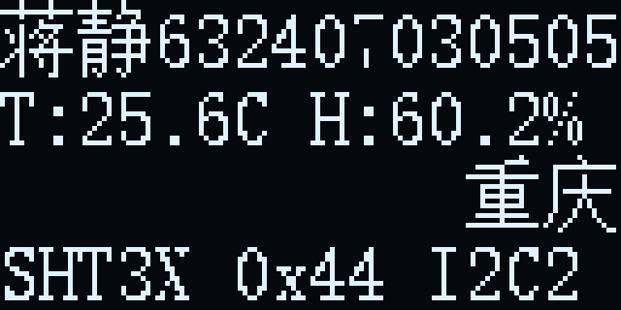

**图 4-1**　任务一的四块内容：姓名学号、温湿度、滚动汉字、传感器状态。这张图是按任务一 `font.c` 里的 8×16 ASCII 和 16×16 汉字点阵直接还原的，滚动偏移取的是中间某一帧。

## 五、任务三：U8g2 的裁剪、移植与动态界面

### 5.1 用 CubeMX 建一个干净的 HAL 工程

任务三没有在任务一的工程上直接改，而是重新建了一个工程，原因是任务一里有 SHT3X、I2C2、自定义 OLED 驱动，直接改容易把原来的东西弄乱。新建工程只保留 OLED 需要的部分：

:one:打开 CubeMX，`New Project`，搜索 `STM32F103C8Tx`，选 LQFP48。

:two:RCC 里 `HSE` 选 `Crystal/Ceramic Resonator`。

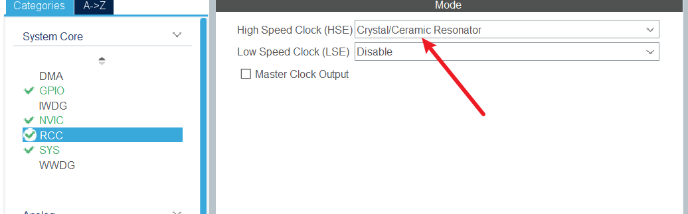

:three:SYS 里 `Debug` 选 `Serial Wire`。

:four:在引脚图上点 PB6，选 `I2C1_SCL`；点 PB7，选 `I2C1_SDA`。CubeMX 会自动把 I2C1 打开。或者直接点I2C1 设置，会默认PB6/7。

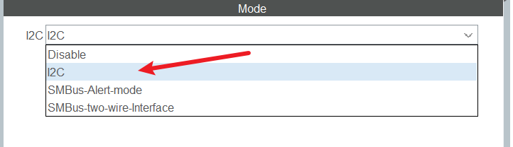

:five:Clock Configuration 里把 HSE 填 8 MHz，PLL Source 选 HSE，PLL Mul 选 ×9，SYSCLK 选 PLLCLK，APB1 选 `/2`，其它默认。这样 SYSCLK=72 MHz，APB1=36 MHz。

:six:Project Manager 里工程名填 `U8G2`，Toolchain 选 `MDK-ARM`，Version 选 V5；Code Generator 勾选“Generate peripheral initialization as a pair of .c/.h files”。

:seven:点 `GENERATE CODE`。

生成的工程里，I2C1 的初始化在 `Core/Src/i2c.c`：

```c
void MX_I2C1_Init(void)
{
  hi2c1.Instance = I2C1;
  hi2c1.Init.ClockSpeed = 100000;                 /* 标准模式 100 kHz */
  hi2c1.Init.DutyCycle = I2C_DUTYCYCLE_2;
  hi2c1.Init.OwnAddress1 = 0;
  hi2c1.Init.AddressingMode = I2C_ADDRESSINGMODE_7BIT;
  hi2c1.Init.DualAddressMode = I2C_DUALADDRESS_DISABLE;
  hi2c1.Init.OwnAddress2 = 0;
  hi2c1.Init.GeneralCallMode = I2C_GENERALCALL_DISABLE;
  hi2c1.Init.NoStretchMode = I2C_NOSTRETCH_DISABLE;
  if (HAL_I2C_Init(&hi2c1) != HAL_OK)
  {
    Error_Handler();
  }
}
```

GPIO 的复用开漏配置在 `HAL_I2C_MspInit()` 里：

```c
GPIO_InitStruct.Pin = GPIO_PIN_6|GPIO_PIN_7;
GPIO_InitStruct.Mode = GPIO_MODE_AF_OD;
GPIO_InitStruct.Pull = GPIO_PULLUP;         
GPIO_InitStruct.Speed = GPIO_SPEED_FREQ_HIGH;
HAL_GPIO_Init(GPIOB, &GPIO_InitStruct);
```

`GPIO_MODE_AF_OD` 是重点。I2C 是开漏总线，只能拉低，不能推高；配成 `GPIO_MODE_AF_PP` 也能“碰巧”显示，但总线竞争时容易出问题。

### 5.2 U8g2 源码裁剪

从 GitHub 下载的 `u8g2-master` 里，`csrc` 目录有 130 个文件，`u8g2_fonts.c` 一个文件就 39.7 MB。直接把整个 `csrc` 加进 Keil 工程，编译慢、Flash 大，而且 `u8g2_d_memory.c` 会给所有屏幕尺寸都定义 static 缓冲区，STM32F103C8T6 的 20 KB RAM 根本装不下。

我参考了博客裁剪，UBG2下载也是根据以下这个博客来的

[https://blog.csdn.net/black_sneak/article/details/126312657](javascript:void(0))

:one:只保留 SSD1306 128×64 的驱动 `u8x8_d_ssd1306_128x64_noname.c`，其它 `u8x8_d_xxx.c` 全部删掉。

:two:`u8g2_d_memory.c` 只留 `u8g2_m_16_8_f()`，它返回 1024 字节的全屏缓冲；其它尺寸的 `u8g2_m_xxx()` 全部删掉。

:three:`u8g2_d_setup.c` 只留 `u8g2_Setup_ssd1306_i2c_128x64_noname_f()`，其它初始化函数删掉。

:four:`u8g2_fonts.c` 只保留 5 个用得到的 ASCII 字库：`u8g2_font_4x6_tf`、`u8g2_font_5x7_tf`、`u8g2_font_6x12_tf`、`u8g2_font_7x13B_tf`、`u8g2_font_9x15B_tf`。中文姓名不用 U8g2 的 GB2312 字库，直接用任务一的 16×16 点阵。

:five:除了上面这些，还要保留 U8g2 的核心文件：`u8g2_setup.c`、`u8g2_buffer.c`、`u8g2_hvline.c`、`u8g2_ll_hvline.c`、`u8g2_font.c`、`u8g2_box.c`、`u8g2_circle.c`、`u8g2_line.c`、`u8g2_bitmap.c`、`u8g2_polygon.c`、`u8g2_arc.c`、`u8g2_intersection.c`、`u8g2_kerning.c`、`u8g2_cleardisplay.c`，以及 U8x8 的 `u8x8_setup.c`、`u8x8_display.c`、`u8x8_byte.c`、`u8x8_cad.c`、`u8x8_gpio.c`、`u8x8_8x8.c`、`u8x8_capture.c`、`u8x8_u16toa.c`。

最后工程里只加了 26 个 `.c` 文件，编译出来 Flash 23.2 KB，RAM 4.3 KB，完全在 STM32F103C8T6 的 64 KB/20 KB 以内。

这里有一个坑：`u8g2_font.c` 会用到 `u8x8_utf8_init()`、`u8x8_ascii_next()`，`u8g2_buffer.c` 会用到 `u8x8_capture_*`，如果只留 `u8g2_fonts.c` 和驱动，链接时会报一堆 `Undefined symbol`。`u8x8_8x8.c`、`u8x8_capture.c`、`u8x8_u16toa.c` 就是补这些符号的，不能省。

### 5.3 移植层：两个回调

U8g2 不直接操作 STM32 的寄存器，它通过两个回调函数和硬件打交道。

第一个是字节发送回调。U8g2 会把一次 I2C 事务拆成 `INIT → START → SEND → END` 几个消息，先把数据攒进 `s_i2c_buf`，收到 `END` 时再用 HAL 一次性发出去：

```c
static uint8_t u8x8_byte_hw_i2c(u8x8_t *u8x8, uint8_t msg,
                                uint8_t arg_int, void *arg_ptr)
{
    uint8_t *data;
    (void)u8x8;

    switch (msg) {
    case U8X8_MSG_BYTE_INIT:
        /* I2C1 已经在 MX_I2C1_Init() 中初始化，这里不用重复初始化 */
        break;

    case U8X8_MSG_BYTE_START_TRANSFER:
        s_i2c_idx = 0U;
        break;

    case U8X8_MSG_BYTE_SEND:
        data = (uint8_t *)arg_ptr;
        while (arg_int > 0U) {
            if (s_i2c_idx >= (uint8_t)sizeof(s_i2c_buf)) {
                return 0U;
            }
            s_i2c_buf[s_i2c_idx++] = *data;
            data++;
            arg_int--;
        }
        break;

    case U8X8_MSG_BYTE_END_TRANSFER:
        if (HAL_I2C_Master_Transmit(&hi2c1, OLED_I2C_ADDR, s_i2c_buf,
                                    s_i2c_idx, I2C_TIMEOUT_MS) != HAL_OK) {
            return 0U;
        }
        break;

    case U8X8_MSG_BYTE_SET_DC:
        /* I2C 接口没有数据/命令选择引脚，忽略 */
        break;

    default:
        return 0U;
    }
    return 1U;
}
```

缓冲区设为 32 字节，是因为 U8g2 保证一次 `START_TRANSFER` 和 `END_TRANSFER` 之间不会超过 32 字节。这个值不能随便改小，否则会丢数据。

第二个是延时/GPIO 回调。U8g2 需要微秒级延时，没有再占一个 TIM1，而是用 Cortex-M3 内核的 DWT 周期计数器：

```c
static void DWT_DelayInit(void)
{
    CoreDebug->DEMCR |= CoreDebug_DEMCR_TRCENA_Msk;
    DWT->CYCCNT = 0U;
    DWT->CTRL |= DWT_CTRL_CYCCNTENA_Msk;
}

static void DWT_DelayUs(uint32_t us)
{
    uint32_t start = DWT->CYCCNT;
    uint32_t ticks = us * (SystemCoreClock / 1000000U);

    while ((DWT->CYCCNT - start) < ticks) {
        /* 空循环，靠 DWT 周期计数器保证微秒级精度 */
    }
}
```

然后把这个回调注册进去：

```c
void U8G2_PortInit(void)
{
    DWT_DelayInit();

    /* 全屏缓冲区版本：_f 后缀表示 1024 字节显存，刷新时整屏发送 */
    u8g2_Setup_ssd1306_i2c_128x64_noname_f(&s_u8g2, U8G2_R0,
                                           u8x8_byte_hw_i2c,
                                           u8x8_gpio_and_delay);
    u8g2_InitDisplay(&s_u8g2);
    u8g2_SetPowerSave(&s_u8g2, 0U);
    u8g2_ClearBuffer(&s_u8g2);
    u8g2_SendBuffer(&s_u8g2);
}
```

`u8g2_Setup_ssd1306_i2c_128x64_noname_f()` 的 `_f` 表示全屏缓冲（1024 字节）。还有 `_1`、`_2` 版本，分别只有 128、256 字节，适合 RAM 特别紧张的芯片，但画滑动动画会不够用，所以这里选 `_f`。

### 5.4 四段式动画：Demo、姓名页、学习标语、小狗

:zero:开头：U8g2 demo 页

:one:第 1 段：姓名“蒋静” + 学号“632407030505” + 祝福语“好运连连”，整页从左往右滑入，停 2 s，再继续往右滑出；

:two:第 2 段：“好好学习天天向上”八个字从屏幕上方往下方滚，经过屏幕中间时停 2 s，再继续往下滑出；

:three:第 3 段：最后停在动态线条小狗页

#### 5.4.0 开头的 U8g2 Demo 页

既然要移植 U8g2，开头先放一个 demo 页比直接上姓名页更直观：能一眼看出 `DrawCircle()`、`DrawRFrame()`、`DrawRBox()`、`DrawDisc()`、`DrawStr()` 这些 API 都跑起来了。


```c
void UI_RenderDemo(u8g2_t *u8g2, uint8_t frame)
{
    uint8_t f = (uint8_t)(frame & 0x07U);
    uint8_t progress = (uint8_t)(10U + (uint8_t)f * 13U);
    int16_t ox = (int16_t)(94 + DEMO_ORBIT_X[f]);
    int16_t oy = (int16_t)(27 + DEMO_ORBIT_Y[f]);

    u8g2_ClearBuffer(u8g2);
    u8g2_SetDrawColor(u8g2, 1U);

    DrawTextCenter(u8g2, 9U, "U8G2 DEMO", u8g2_font_5x7_tf);

    /* 左边：圆角框 + U8g2 大字 + 小字 */
    u8g2_DrawRFrame(u8g2, 4U, 16U, 50U, 32U, 5U);
    u8g2_SetFont(u8g2, u8g2_font_9x15B_tf);
    u8g2_DrawStr(u8g2, 8U, 36U, "U8g2");
    u8g2_SetFont(u8g2, u8g2_font_4x6_tf);
    u8g2_DrawStr(u8g2, 8U, 44U, "U8G2 LIB");

    /* 右边：圆 + 旋转小点，演示基础图形 API */
    u8g2_DrawCircle(u8g2, 94U, 27U, 15U, U8G2_DRAW_ALL);
    u8g2_DrawDisc(u8g2, 94U, 27U, 3U, U8G2_DRAW_ALL);
    u8g2_DrawLine(u8g2, 94U, 27U, (u8g2_uint_t)ox, (u8g2_uint_t)oy);
    u8g2_DrawDisc(u8g2, (u8g2_uint_t)ox, (u8g2_uint_t)oy, 2U, U8G2_DRAW_ALL);

    /* 屏幕尺寸和总线信息 */
    u8g2_DrawStr(u8g2, 78U, 50U, "128x64");
    u8g2_DrawStr(u8g2, 108U, 50U, "I2C");

    /* 底部进度条：8 帧走一遍 */
    u8g2_DrawRFrame(u8g2, 6U, 54U, 116U, 8U, 4U);
    u8g2_DrawRBox(u8g2, 8U, 56U, progress, 4U, 2U);
}
```

旋转小点的位置来自一张 8 个方向的坐标表：

```c
static const int8_t DEMO_ORBIT_X[8] = {14, 10, 0, -10, -14, -10, 0, 10};
static const int8_t DEMO_ORBIT_Y[8] = {0, 10, 14, 10, 0, -10, -14, -10};
```

`frame` 从 0 走到 7，`progress` 从 10 走到 101，底部进度条就跟着变长；`ox/oy` 让右边的小点绕着圆周转一圈。8 帧走完，`UI_Task()` 把状态切到 `PH_NAME_IN`。

#### 5.4.1 姓名页：从左往右


第一段：姓名、学号、“好运连连”。整页 128 像素宽，作为一个整体从左往右移动。

姓名页的布局是算过的：`HELLO, I AM` 用 4×6 小字放在顶部；两个 16×16 汉字放在 y=10，宽 32 像素，水平居中；学号 12 位，用 7×13 粗体，宽 84 像素，x=22 正好居中；下面一条 88 像素的分隔线；“好运连连”四个 16×16 汉字放在 y=47，宽 64 像素。

```c
void UI_RenderNamePage(u8g2_t *u8g2)
{
    u8g2_ClearBuffer(u8g2);
    u8g2_SetDrawColor(u8g2, 1U);

    /* 顶部小标题 */
    DrawTextCenter(u8g2, 8U, "HELLO, I AM", u8g2_font_4x6_tf);

    /* 姓名：两个 16x16 汉字，水平居中 */
    DrawHZ16At(u8g2, 48, 10, HZ_JIANG);
    DrawHZ16At(u8g2, 64, 10, HZ_JING);

    /* 学号：7x13 粗体，12 位宽 84 像素，水平居中 */
    u8g2_SetFont(u8g2, u8g2_font_7x13B_tf);
    u8g2_DrawStr(u8g2, 22U, 39U, "632407030505");

    /* 分隔线 */
    u8g2_DrawHLine(u8g2, 20U, 43U, 88U);

    /* 祝福语：好运连连 */
    DrawGlyphRun(u8g2, 32, 47, LUCKY_GLYPHS, 4U);
}
```

姓名页整页 128 像素宽，正好等于屏幕宽度。如果直接给 `u8g2_DrawStr()` 传负的 x，`u8g2_uint_t` 会把它当成 236，文字就没了。所以我在 `UI_Init()` 里先把整页画进 `s_name_buf`，之后只做显存平移：

```c
static void ComposeNameShift(int16_t offset)
{
    u8g2_t *u8g2 = U8G2_GetHandle();
    uint8_t *out = u8g2_GetBufferPtr(u8g2);
    int16_t x, y, sx;

    memset(out, 0x00, OLED_BUF_SIZE);

    for (y = 0; y < 64; y++) {
        for (x = 0; x < 128; x++) {
            sx = (int16_t)(x - offset);
            if ((sx >= 0) && (sx < 128) &&
                (BufGetPixel(s_name_buf, (uint8_t)sx, (uint8_t)y) != 0U)) {
                BufSetPixel(out, (uint8_t)x, (uint8_t)y);
            }
        }
    }

    u8g2_SendBuffer(u8g2);
}
```

`offset` 是姓名页左边缘在屏幕上的 x 坐标：`-128` 时整页在屏幕左边外面，`0` 时完整显示，`+128` 时整页在右边外面。每 80 ms 加 12，所以看起来是“从左往右推入”，停 2 s 后再继续往右推出去。

#### 5.4.2 学习标语：自上往下

“好好学习天天向上”一共 8 个汉字，每个 16×16，正好 8 × 16 = 128 像素宽，所以可以做成一行，从屏幕上方向下滚。

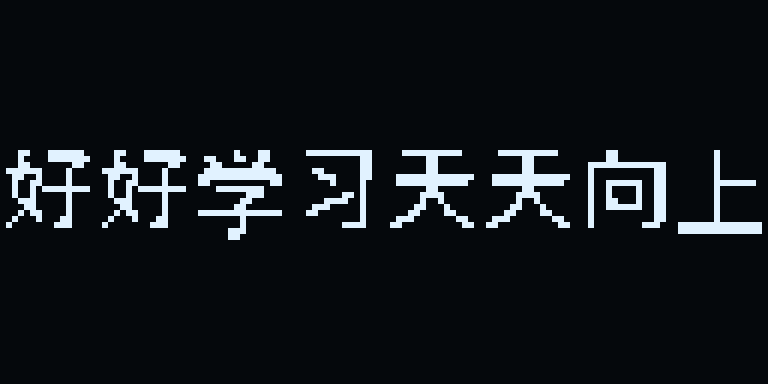

第二段：“好好学习天天向上”停在屏幕中间的样子。八个字正好占满 128 像素宽，不需要左右裁剪。

因为 y 会从 -16 走到 64，不能直接调用 U8g2 的 `DrawStr()`，所以我写了一个带符号坐标的汉字绘制函数，逐像素判断是否在屏幕内：

```c
static void DrawHZ16At(u8g2_t *u8g2, int16_t x, int16_t y, const uint8_t *hz)
{
    int16_t col, row, px, py;
    uint8_t top, bottom;

    for (col = 0; col < 16; col++) {
        top = hz[col];
        bottom = hz[col + 16];
        for (row = 0; row < 8; row++) {
            if ((top & (uint8_t)(1U << row)) != 0U) {
                px = (int16_t)(x + col);
                py = (int16_t)(y + row);
                if ((px >= 0) && (px < SCREEN_W) &&
                    (py >= 0) && (py < SCREEN_H)) {
                    u8g2_DrawPixel(u8g2, (u8g2_uint_t)px, (u8g2_uint_t)py);
                }
            }
            if ((bottom & (uint8_t)(1U << row)) != 0U) {
                px = (int16_t)(x + col);
                py = (int16_t)(y + 8 + row);
                if ((px >= 0) && (px < SCREEN_W) &&
                    (py >= 0) && (py < SCREEN_H)) {
                    u8g2_DrawPixel(u8g2, (u8g2_uint_t)px, (u8g2_uint_t)py);
                }
            }
        }
    }
}
```

绘制标语本身很简单：

```c
void UI_RenderStudy(u8g2_t *u8g2, int16_t y)
{
    u8g2_ClearBuffer(u8g2);
    u8g2_SetDrawColor(u8g2, 1U);

    /* 八个字正好 8 × 16 = 128 像素宽，从屏幕上方往下方滚 */
    DrawGlyphRun(u8g2, 0, y, STUDY_GLYPHS, 8U);
}
```

`y` 从 `-16` 开始，每次加 4，到 `24` 时整行完整落在屏幕中间，停 2 s；再继续加 4，直到 `64`，整行从下面出去。这个过程就是“自上往下滚动”。

#### 5.4.3 动态线条小狗

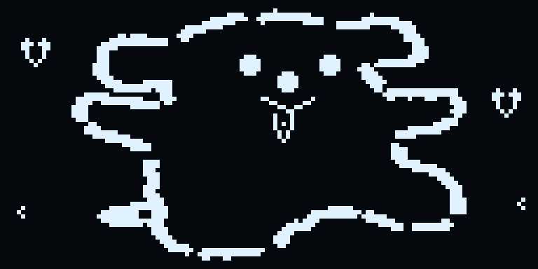

小狗的做法分两部分：

:one:身体轮廓用 96×60 的 XBM 位图。位图在 `dog_bitmap.c` 里，是把原图去掉脸部后缩放到 96×60、再二值化得到的。脸部区域留白，方便后面动态画。

:two:眼睛、鼻子、嘴、舌头用 U8g2 的 `DrawDisc()`、`DrawLine()`、`DrawHLine()` 实时画。这样不用为每个表情存一整张 96×60 的位图，Flash 省很多，改表情也方便。

```c
void UI_RenderDog(u8g2_t *u8g2, uint8_t anim_frame)
{
    uint8_t f = (uint8_t)(anim_frame & 0x0FU);
    uint8_t bob = (uint8_t)((f >> 2) & 0x01U);
    uint8_t hy = (uint8_t)(10U + (uint8_t)((f >> 1) % 4U));

    u8g2_ClearBuffer(u8g2);
    u8g2_SetDrawColor(u8g2, 1U);

    /* 身体：上下浮动 1 像素，看起来像在呼吸 */
    u8g2_DrawXBMP(u8g2, 16U, (u8g2_uint_t)(2U + bob),
                  DOG_BITMAP_W, DOG_BITMAP_H, DOG_BITMAP);

    /* 脸和舌头 */
    DrawDogFace(u8g2, 16U, (uint8_t)(2U + bob), f);

    /* 两侧漂浮的小爱心 */
    DrawHeart(u8g2, 8U, hy);
    DrawHeart(u8g2, 120U, (uint8_t)(22U + (uint8_t)((f >> 1) % 5U)));

    /* 点缀的小星星 */
    if ((f & 0x03U) < 2U) {
        u8g2_DrawPixel(u8g2, 4U, 50U);
        u8g2_DrawPixel(u8g2, 5U, 49U);
        u8g2_DrawPixel(u8g2, 5U, 51U);
        u8g2_DrawPixel(u8g2, 123U, 48U);
        u8g2_DrawPixel(u8g2, 124U, 47U);
        u8g2_DrawPixel(u8g2, 124U, 49U);
    }
}
```

脸的画法：

```c
static void DrawDogFace(u8g2_t *u8g2, uint8_t ox, uint8_t oy, uint8_t frame)
{
    uint8_t blink = (uint8_t)((frame == 10U) || (frame == 11U));
    int8_t wiggle = 0;
    uint8_t tx;

    if ((frame & 0x03U) == 0U) {
        wiggle = -1;
    } else if ((frame & 0x03U) == 2U) {
        wiggle = 1;
    }

    /* 眼睛：平时是两个圆点，第 10、11 帧变成横线，表示眨眼 */
    if (blink != 0U) {
        u8g2_DrawHLine(u8g2, (u8g2_uint_t)(ox + 40U),
                       (u8g2_uint_t)(oy + 13U), 5U);
        u8g2_DrawHLine(u8g2, (u8g2_uint_t)(ox + 59U),
                       (u8g2_uint_t)(oy + 13U), 5U);
    } else {
        u8g2_DrawDisc(u8g2, (u8g2_uint_t)(ox + 43U),
                      (u8g2_uint_t)(oy + 13U), 2U, U8G2_DRAW_ALL);
        u8g2_DrawDisc(u8g2, (u8g2_uint_t)(ox + 62U),
                      (u8g2_uint_t)(oy + 13U), 2U, U8G2_DRAW_ALL);
    }

    /* 鼻子：一个小圆点 */
    u8g2_DrawDisc(u8g2, (u8g2_uint_t)(ox + 52U),
                  (u8g2_uint_t)(oy + 17U), 2U, U8G2_DRAW_ALL);

    /* 嘴巴：两段斜线组成微笑 */
    u8g2_DrawLine(u8g2, (u8g2_uint_t)(ox + 46U),
                  (u8g2_uint_t)(oy + 21U),
                  (u8g2_uint_t)(ox + 52U), (u8g2_uint_t)(oy + 24U));
    u8g2_DrawLine(u8g2, (u8g2_uint_t)(ox + 52U),
                  (u8g2_uint_t)(oy + 24U),
                  (u8g2_uint_t)(ox + 58U), (u8g2_uint_t)(oy + 21U));

    /* 舌头：白色轮廓的小 U 形，左右摆一像素 */
    tx = (uint8_t)(ox + 52U + wiggle);
    u8g2_DrawLine(u8g2, (u8g2_uint_t)(tx - 2U),
                  (u8g2_uint_t)(oy + 25U),
                  (u8g2_uint_t)(tx - 2U), (u8g2_uint_t)(oy + 28U));
    u8g2_DrawLine(u8g2, (u8g2_uint_t)(tx + 2U),
                  (u8g2_uint_t)(oy + 25U),
                  (u8g2_uint_t)(tx + 2U), (u8g2_uint_t)(oy + 28U));
    u8g2_DrawLine(u8g2, (u8g2_uint_t)(tx - 2U),
                  (u8g2_uint_t)(oy + 28U),
                  (u8g2_uint_t)tx, (u8g2_uint_t)(oy + 31U));
    u8g2_DrawLine(u8g2, (u8g2_uint_t)(tx + 2U),
                  (u8g2_uint_t)(oy + 28U),
                  (u8g2_uint_t)tx, (u8g2_uint_t)(oy + 31U));
    u8g2_DrawPixel(u8g2, (u8g2_uint_t)tx, (u8g2_uint_t)(oy + 27U));
}
```

小狗的动画参数：

| 帧号 | 效果 |
| --- | --- |
| `f & 3` | 舌头左/中/右摆动 |
| `f == 10/11` | 眼睛变横线，眨眼 |
| `(f >> 2) & 1` | 身体上下浮动 1 像素 |
| `(f >> 1) % 4` | 左侧爱心上下漂 |
| `(f >> 1) % 5` | 右侧爱心上下漂 |

### 5.5 四段式调度：不用 HAL_Delay 卡住

如果每一段用 `HAL_Delay()`，主循环会被卡死，小狗就没法在停留时继续动。所以全部用 `HAL_GetTick()` 做非阻塞调度：

```c
void UI_Task(void)
{
    uint32_t now = HAL_GetTick();

    switch (s_phase) {
    case PH_DEMO:
        if ((uint32_t)(now - s_tick) >= DEMO_FRAME_MS) {
            s_tick = now;
            s_demo_frame++;
            if (s_demo_frame >= 8U) {
                s_phase = PH_NAME_IN;
                s_name_offset = NAME_START;
                s_tick = now;
                ComposeNameShift(s_name_offset);
            } else {
                SendDemoPage(s_demo_frame);
            }
        }
        break;

    case PH_NAME_IN:
        if ((uint32_t)(now - s_tick) >= TRANS_MS) {
            s_tick = now;
            s_name_offset = (int16_t)(s_name_offset + NAME_STEP);
            if (s_name_offset >= 0) {
                s_name_offset = 0;
                s_phase = PH_NAME_HOLD;
                SendNamePage(0);
            } else {
                ComposeNameShift(s_name_offset);
            }
        }
        break;

    case PH_NAME_HOLD:
        if ((uint32_t)(now - s_tick) >= NAME_HOLD_MS) {
            s_phase = PH_NAME_OUT;
            s_tick = now;
        }
        break;

    case PH_NAME_OUT:
        if ((uint32_t)(now - s_tick) >= TRANS_MS) {
            s_tick = now;
            s_name_offset = (int16_t)(s_name_offset + NAME_STEP);
            if (s_name_offset >= NAME_END) {
                s_phase = PH_STUDY_IN;
                s_study_y = STUDY_TOP;
                s_tick = now;
                SendStudyPage(s_study_y);
            } else {
                ComposeNameShift(s_name_offset);
            }
        }
        break;

    case PH_STUDY_IN:
        if ((uint32_t)(now - s_tick) >= TRANS_MS) {
            s_tick = now;
            s_study_y = (int16_t)(s_study_y + STUDY_STEP);
            if (s_study_y >= STUDY_CENTER) {
                s_study_y = STUDY_CENTER;
                s_phase = PH_STUDY_HOLD;
                s_tick = now;
            }
            SendStudyPage(s_study_y);
        }
        break;

    case PH_STUDY_HOLD:
        if ((uint32_t)(now - s_tick) >= STUDY_HOLD_MS) {
            s_phase = PH_STUDY_OUT;
            s_tick = now;
        }
        break;

    case PH_STUDY_OUT:
        if ((uint32_t)(now - s_tick) >= TRANS_MS) {
            s_tick = now;
            s_study_y = (int16_t)(s_study_y + STUDY_STEP);
            if (s_study_y >= STUDY_BOTTOM) {
                s_phase = PH_DOG;
                s_dog_frame = 0U;
                s_tick = now;
                SendDogPage(s_dog_frame);
            } else {
                SendStudyPage(s_study_y);
            }
        }
        break;

    case PH_DOG:
    default:
        if ((uint32_t)(now - s_tick) >= DOG_FRAME_MS) {
            s_tick = now;
            s_dog_frame = (uint8_t)((s_dog_frame + 1U) & 0x0FU);
            SendDogPage(s_dog_frame);
        }
        break;
    }
}
```

状态机：

```text
DEMO → NAME_IN → NAME_HOLD → NAME_OUT → STUDY_IN → STUDY_HOLD → STUDY_OUT → DOG
```

### 5.6 main.c 和 Keil 工程

`main.c` 只做初始化，然后把主循环交给 `UI_Task()`：

```c
int main(void)
{
  HAL_Init();
  SystemClock_Config();

  MX_GPIO_Init();
  MX_I2C1_Init();

  UI_Init();                    /* 初始化 U8g2，先播 Demo */

  while (1)
  {
    UI_Task();                  /* 非阻塞页面调度 + 小狗动画 */
    HAL_Delay(1);
  }
}
```

`UI_Init()` 先把姓名页画进 `s_name_buf`，然后状态设成 `PH_DEMO`，先播 8 帧 demo；demo 结束后状态切到 `PH_NAME_IN`，offset 从 `-128` 开始，姓名页再从左边进入。

Keil 工程里要加的东西：

:one:把 `Middlewares/U8g2` 下的 26 个 `.c` 文件加进 `Middlewares/U8g2` 组；

:two:把 `dog_bitmap.c` 加进 `Application/User/Core` 组；

:three:在 `Options for Target → C/C++ → Include Paths` 里加 `../Middlewares/U8g2`；

:four:在 `Define` 里保留 `USE_HAL_DRIVER, STM32F103xB`，C 语言选 C99，勾选 `One ELF Section per Function`。

### 5.7 最终效果

Demo 页：

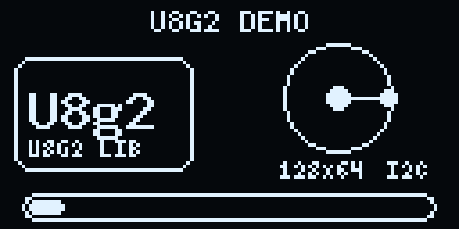

开头的 U8g2 demo

姓名页：

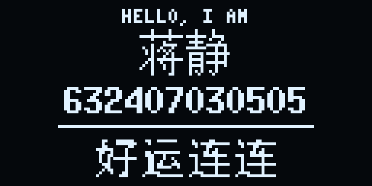

姓名、学号、“好运连连”。这三样东西是一起从左往右滑动的，不是分开动。

学习标语：


“好好学习天天向上”停在屏幕中间。八个字正好 128 像素宽，左右没有空隙。

小狗页：


线条小狗，嘴巴下面有舌头，两侧有爱心。

## 六、Keil 虚拟逻辑分析仪和 I2C 波形

### 6.1 Keil 的逻辑分析仪到底能看什么

Keil 的 `Logic Analyzer` 是在**软件仿真**（Simulator）下工作的，它看的是仿真模型里引脚的电平变化，不是真实板子上的电压。也就是说：

- 如果代码是**软件模拟 I2C**（用 GPIO 一位一位翻转 SCL/SDA），逻辑分析仪能看到比较完整的 SCL/SDA 波形，因为每次 `GPIO_WritePin()` 都会改变仿真引脚电平；
- 如果代码是**硬件 I2C**（本实验用的 `HAL_I2C_Master_Transmit()`），I2C 的时序由 STM32 的 I2C 外设自动产生，Keil 的 STM32F103 仿真模型不一定把外设内部的状态完整映射到 PB6/PB7 的引脚上，逻辑分析仪很可能只看到一条直线（空闲高电平），或者只有很零碎的跳变。

所以“用 Keil 的逻辑分析仪采 SDA 波形”这件事，本身要看用的是硬件 I2C 还是软件 I2C。硬件 I2C 在仿真里抓不到完整协议，是正常现象，不一定是代码错了。

### 6.2 为什么仿真里经常是一条直线

常见原因有四个：

:one:**没有从机模型**。仿真器里有 STM32，但没有 SSD1306。主机发地址后等 ACK，从机永远不响应，I2C 外设可能停在等待状态，引脚就不再产生后续时钟。

:two:**硬件 I2C 的外设模型不完整**。Keil 的器件仿真模型对 GPIO 翻转的支持比较好，对 I2C、SPI 这类外设的内部移位寄存器、时钟拉伸、ACK 时序，往往只做“寄存器级”模拟，不一定把波形推到引脚。

:three:**逻辑分析仪加的是 GPIO 端口，不是 I2C 外设内部信号**。例如加 `PORTB.6`、`PORTB.7`，看到的是引脚；如果外设没有真正驱动引脚，就是直线。

:four:**代码在 `HAL_I2C_Master_Transmit()` 里等待标志位**。仿真时如果标志位模型不翻转，程序会卡在超时循环里，逻辑分析仪自然没有后续波形。

### 6.4 我的结论

Keil 的虚拟逻辑分析仪适合看**软件 GPIO 翻转**，不适合用来验证**硬件 I2C 与真实从机的完整协议**。


## 七、实验总结

这次实验我把任务一和任务三放在一起做，最大的感受是：**OLED 显示看起来只是“点亮屏幕”，但背后从 I2C 时序、SSD1306 显存、汉字点阵，到 U8g2 的移植层、缓冲区、页面调度，每一层都有坑。**

任务一让我把底层走了一遍：自己写 `OLED_GRAM`、自己发命令、自己算页地址和列地址、自己处理 8×16 和 16×16 点阵。任务三则让我站到库的层面：U8g2 把 SSD1306 的命令、字库、图形算法都封装好了，我只需要实现两个回调，就能用 `DrawCircle()`、`DrawRBox()`、`DrawStr()` 这些 API 快速做界面。两者不是替代关系，而是“知道底层，才能把库用对”。

如果继续优化，我想做三件事：把 I2C 提到 400 kHz 并加 DMA，减少整屏发送的阻塞；把小狗做成多组动作而不是单一循环；再给三段动画加一个按键跳过，而不是只能等它自己播完。
